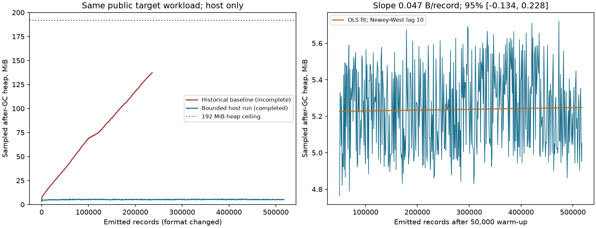

# B06 bounded observer and native diagnostics

Status: offline implementation and full host memory acceptance complete; engineering hold remains.
Final publication CI is still required before commit-specific merge approval.

Howard's decision dated 2026-10-10 17:44 PDT supersedes the host reproduction
prerequisite. The historical ~560 bytes/event retained growth and the mismatch
between host and native payload tails justify this work; they do not prove the
native OOM's initiating cause.

The new opt-in `bounded-observer-v1` format streams class definitions on first
sight. A private disk index stores class identity, definition hash and prepared
state, with a fixed 256-entry heap cache and 262,144 slots. Pending activations
retain matching identifiers and entry age in 512 preallocated slots, with a hard
512-activation cap. Pre-dispatch refusal witnesses also use fixed storage, so
releasing or reusing a slot cannot change the captured refusal operands.
Return records reference the already emitted entry. Completed payloads are not
retained. Checkpoint frames reference class definitions rather than duplicating
constant pools and method bodies. Binary fields are base64; the JSON writer uses
bounded chunks. Audit records use a bounded record buffer. Diagnostic metadata uses a stateless
versioned DEFLATE/base64 envelope with a fixed public dictionary; quotas count
original wire bytes and readers reconstruct every field. Refusal context stays
directly inspectable. The older detail encoding remains readable. The
[full-stream comparison](b06-compact-diagnostic-wire.json) preserves all 273,061
diagnostic records while reducing 134,217,565 bytes to 52,562,139 (2.55×).

The engineering-only JDI mirror adapter bounds the JDK's own strong class cache
to 1,024 mirrors (512 low-water), retaining active and unprepared types. It uses
exact-name JDWP queries and refuses full enumeration or unsupported runtime
bytes. All seven pinned JDI class hashes match the preserved public image
catalogue; actual runtime bytes are rechecked before collection. See
[binding and lifecycle tests](b06-jdi-mirror-adapter.md).

Routine set-open/dispatch/resume traffic is aggregated. Every dispatched event
retains request, method, thread, depth and arm information; a refusal adds the
full pending context captured before dispatch. Lifecycle and heap metadata share
the unchanged 500,000-record / 128 MiB diagnostic quota. The original 50,000
ordinary-evidence cap remains. No evidence cap has been raised.

Native diagnostics bind strict or diagnostic mode, a ten-unmatched-return cap,
heap telemetry each 1,000 events and an 85% resource guard. The guard suspends for
a broker-collected histogram and a signed stop receipt; an OOM dump remains in
owned private output. Application phase receipts bind existing worker/checkpoint
markers to observed generation-entry counts. They do not invent business-phase
inference. Java receives a 1,536 MiB heap, zero soft-reference retention policy,
and a private state directory; the observer container limit is 2,048 MiB.

The engineering authority is separate. Its public fingerprint is
`4ce00cfa28c13f74c12e6569b6aae010fe7e7185849accad8340c2fc367be9f0`.
Admission rejects that signing identity even after labels or paths are changed.
Only its public PEM is versioned. All engineering entry points remain held.

The prospective request is limited to two Oracle-only retained-reference J1
attempts: strict first, diagnostic second. Each has 60 minutes work and ten
minutes cleanup, a 30-minute candidate timeout, zero models and zero credit.
The exact implementation/classes/template hashes and proposed calendar are being
bound in the held two-attempt request; no approval or native execution is implied.

## Preserved native evidence and limits of the inference

The prior r3 stream contains 12,396 generation entries, compared with 12,394 in
diagnostic r1 and 12,414 in practice r1. More audit records did not establish
further application progress. Its five accepted unmatched returns are at records
230,866, 230,910, 230,949, 230,994 and 231,011; the OOM follows 147 records after
the last. The final audit identifies `ClassDefiner.defineClass` at depth 110.
A shared application phase is a hypothesis, not an established cause.

The historical host baseline retained about 560 bytes/event. Native definition
inputs reached about 262 KB versus 10 KB on the host; native class-data graphs
had median 110 nodes versus one, and depths reached 213 versus 131. After-GC
sampling misses serialization peaks. These differences explain why failure to
reproduce the native OOM did not justify postponing bounded-memory work.

The [historical audit comparison](b06-historical-audit-compatibility.json) checks
both signed incomplete streams using the old and current structural readers.
Neither is upgraded to a complete provenance replay or a qualification pass.
[Host alternatives measurements](https://github.com/howardweale/lightyear-carddemo-modernization/pull/319)
are a separate deliverable. After two explicitly approved native attempts, an
unresolved initiating cause requires Howard to choose the next design; no further
observer repair attempt is automatic.

## Validation record

- Existing historical readers remain available for their original formats.
- 104 focused checks passed with eleven optional skips before the final audit
  aggregation changes; updated final-head validation is still required.
- The exploratory bounded payload variant avoided OOM but hit the unchanged
  audit byte cap after 29,360 generation entries. Peak sampled after-GC heap was
  34,200,992 bytes. That run is preserved and is not an acceptance pass.
- The second variant stayed below 17,565,256 bytes after GC but reached the
  128 MiB metadata quota at 27,907 generation entries. Its fitted retained
  growth remained positive: 32.07 bytes/emitted record, 95% interval
  31.82–32.33. This is not a flat-curve pass.
- The first mirror-cache variant stopped at its pin guard: unknown JDI
  preparation status was conservatively retained. The correction reads actual
  status outside the JDI cache lock; genuinely unprepared mirrors remain pinned.
- The fourth variant bounded JDI mirrors and stayed below 6,736,736 bytes after
  GC, but stopped at 27,388 generation entries on the unchanged 128 MiB metadata
  cap. Its slope was still positive: 0.564 bytes/emitted record, 95% interval
  0.181–0.947. It is preserved as a failed acceptance attempt. Fixed retained
  pending/witness storage and further lossless metadata compaction are now being
  validated in the later sixth run recorded below. This fourth run remains failed.
- The fifth variant reached 37,560 generation entries with peak after-GC heap
  5,937,600 bytes and slope -0.133 bytes/record (95% interval -0.302 to 0.036),
  but the unchanged synthetic suppression workload exhausted the proposed
  256 pending slots. Its [preserved result](b06-bounded-memory-r5.json) is not
  an acceptance pass. The fixed pending/witness pools are now sized to 512;
  the extra capacity is preallocated and its exhaustion still stops. This is
  a proposed implementation resource limit, not an increase to the 128 MiB,
  500,000-audit or 50,000 ordinary-evidence limits. The unchanged full workload
  completed in the sixth run below; the fifth run remains incomplete.
- A production-serializer transient test passed with a 1 MiB definition and
  4,096-node graph resident at 85% occupancy of a 192 MiB heap. Final-source
  measurements are published below.

## Completed host acceptance — 2026-10-11

The [sixth result](b06-bounded-memory-r6.json) completed the full three-thread,
1,400-iterations-per-thread public workload at a **192 MiB** observer heap:
**40,979 generation entries**, 517,232 emitted records, both process return
codes zero, no timeout or OOM, **1,446.094 seconds** elapsed. Peak sampled
after-GC heap was **5,998,544 bytes (5.72 MiB)**; the last sample was 5,298,056.

The fixed 50,000-record warm-up leaves 469 samples. OLS with a Newey-West
Bartlett lag-10 interval gives **0.04691 bytes/emitted record**, asymptotic
95% interval **[-0.13384, 0.22767]**. The slope is not significantly above zero,
meeting the specified host criterion. This is finite-workload evidence, not a
proof of zero growth for every future payload or runtime.

The target fixture, generated 3,000-class/depth-100 stack fixture, worker count,
iterations, heap and deliberate return-suppression interval match the preserved
baseline. Harness hashes differ because bounded initialization, streamed sampling,
exact watched-type bootstrap and mirror pruning were added; both hashes are
published. Emitted-record formats differ, so generation counts are reported
separately. The [published CSV](b06-bounded-memory-r6.csv) contains the same parsed
rows as the private raw CSV, normalized to UTF-8/LF; its own hash and the raw
hash are distinct and recorded. The r5 public CSV likewise normalizes line endings;
its raw-hash field refers to its preserved local original.

Historical r3 had 206,365 audit records / 12,396 generation entries =
**16.65 audit records/call**. The completed host run has 245,413 / 40,979 =
**5.99 audit records/call**. Including all 163,004 new lifecycle records, its
408,417 diagnostic metadata records total **80,229,670 bytes (76.51 MiB)**,
**9.97 metadata records/call**, below both unchanged metadata bounds. This
host/native comparison describes measured volumes; it does not prove that a
full native pair fits. The host harness deliberately suppresses returns and
leaves 235 pending activations to test retention; it is not a native admission
run and does not relax the native ten-unmatched-return or ordinary-evidence cap.

The [current-source transient test](b06-bounded-transient-r4.json) starts with
171,157,312 bytes resident (at least 85% of 201,326,592). A 1 MiB definition and
4,096-node graph serialize in 43.155 ms without OOM, allocating **26,741,384
bytes**. The sampled serialization peak is 181,605,808 bytes; a conservative
allocation upper bound is 197,898,696 bytes. The 1,661,086-byte output matches
an independently serialized reference exactly. Sampling can miss a shorter peak;
the allocation bound is reported separately.

The implementation source is `02b2f7fd4080bfbcd821ef51147c455d7f57620eac797b809d406d73f935c64b`;
all fourteen compiled class hashes, raw output hashes, curve and fit are in the
result. The Linux JDI CI job passed on implementation head `fe259dbf1d429d10c625e8141adc6b2e86736f8e`.
Its final publication head must also complete green. Forty-nine additional focused
engineering/diagnostic/pending-pool/codec tests passed, including the two-attempt
full-budget boundaries. No acceptance is inferred from an unfinished CI job.

No Docker, native application, model or customer-data execution occurred.
All historical failures remain failed. Green final-head CI and Howard's
commit-specific merge approval are required; this document grants neither.
