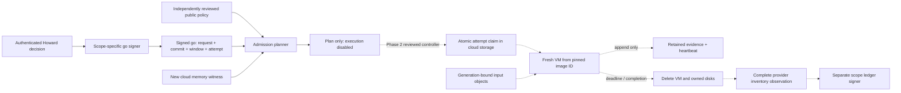

# Cloud runner lifecycle and activation boundary

October 13, 2026. Phase 1 branch implementation; no deployment or run authority.

## Architecture

Solid edges describe the implemented offline admission boundary. Dotted edges are
the later live controller integration; they are not deployed or exercised.
The injected KMS adapter is tested with fixture transports and verifies its
returned signature without trusting the transport alone.

## Authority and tenant isolation

Use separate go, witness and ledger keys for each of engineering, qualification
and factory. The same Ed25519 format does not make those authorities interchangeable.
Neither worker nor launcher can sign a go, mint a witness or approve cleanup.
Customer deployments get an entirely separate project, buckets, KMS ring, WIF
policy and trust policy; customer code/data never traverse the Lightyear project.
The request binds data project equal to execution project; all input refs match
that policy's bucket. Avoid public object names containing customer secrets.

Federation binds immutable GitHub owner/repository IDs, the exact workflow ref,
branch, manual-dispatch event and protected-environment subject. It is disabled
by default. The future privileged controller should be a reviewed, immutable
deployment separate from a caller's arbitrary branch code. A SHA comparison in
an untrusted branch workflow does not create an independent security boundary.

## Future live controller requirements

The following is the Phase 2 implementation checklist, not a claim of completion:

1. Fetch the reviewed policy independently, validate its hash, then fetch request,
   go, witness and inputs by pinned GCS generations. Verify size and SHA-256, locked
   retention and retained-until dates through provider metadata. Recheck all request
   and go bindings at launch time. A plan made yesterday cannot authorize today.
2. Create `attempts/<attempt_id>` using generation-match zero before VM creation.
   On conflict or ambiguous create response, reconcile the same claim; never choose
   a fresh name to escape a consumed attempt. Claim ownership, request seal, cloud
   request ID and resulting numeric VM/disk IDs are durable, append-only records.
3. Create one VM with no public address, automatic restart disabled, no arbitrary
   startup command supplied by a request, and a provider-enforced lifetime limit.
   Verify numeric image identity again immediately before creation. Require the
   reviewed boot agent and container digests; do not run mutable package installs.
4. Worker verifies local input bytes and actual boot resources before the campaign.
   Recheck the newly signed witness against the chosen image/machine configuration.
   A current free-memory check supplements, rather than replaces, the cloud
   experiment's required memory proof. Qualification keeps its own admission rules.
5. Emit append-only sequence-numbered heartbeat/evidence objects with
   generation-match zero. A separate controller alerts on stale heartbeats and
   enforces timeout; the worker cannot be solely responsible for its own cleanup.
   Use Cloud Logging with reviewed retention and no sensitive payload leakage.
6. In a finally/reconciliation path, record and wait for the exact delete operation,
   then enumerate every page of instances and disks across the relevant project.
   Check numeric IDs as well as attempt labels. API errors, inaccessible zones,
   warnings, missing pages, surviving disks or evidence-upload failure leave
   cleanup OPEN and block any final sealed success.
7. Independently authorized ledger service verifies those observations and evidence
   manifest hashes before KMS signing. Store the final ledger by hash in retained
   storage. Failed attempts preserve their evidence and cannot become successful
   through cleanup alone. Deletion inventory is a provider observation under the
   controller's identity, not an independent attestation or proof of physical erasure.

The pure `cleanup_observation` function checks the evidence shape, sequence and
absence rules for normalized, authenticated provider responses. It does not make
API calls or turn caller-supplied JSON into provider authentication. There is
deliberately no production runner transport to accidentally activate in Phase 1.

## Retention and recovery

Input and evidence buckets are separate and versioned. Generation numbers, content
hashes and expected sizes are all bound. Versioning alone does not prevent deletion;
a locked retention policy protects retained generations for its configured duration.
Use create-only uploads even for hash-named files and verify the returned generation.
A new object with the same name must not silently replace the referenced generation.
Do not put a mutable overwrite-only heartbeat under a retention lock; use a sequence
of immutable heartbeat objects and a separately derived read-only status view.

Terraform's prevent-destroy guard is an operator safeguard, not the cloud retention
guarantee. The lock requires a separate irreversible-action approval. Protect state,
public trust records and key versions against accidental deletion; test restore and
scheduled key-destruction controls. The Phase 1 ring uses a 30-day key destruction
delay and creates no signing IAM grants.

## AWS reproduction boundary

Reuse the public canonical message/signature contract, container digests, object
hash inventory and result schema. Implement an AWS-specific signer transport,
Terraform module, object-version mapping and provider inventory adapter in Phase 5.
AWS has Ed25519 support, but algorithm/message-mode interoperability must be tested
with shared vectors before claiming byte-compatible signatures. Re-establish memory
proof on the AWS machine type. Report independently reproduced result hashes and
differences; never relabel a GCP run as AWS evidence.

## Stand-up decisions still needed

| Decision | Proposed value | Status |
| --- | --- | --- |
| Primary cloud | Google Cloud | Design direction accepted for this implementation |
| Project and billing account | None supplied | Required before provision |
| Region | us-west1 | Review default |
| Retention | 365 days | Explicit irreversible-lock approval still required |
| Phase 2 cap | $200 proposal | No spend authorization inferred from attachment checkboxes |
| VM | n2-standard-16 example | Benchmark, quota and memory witness required |
| Runtime bundle | Exact JDK 21, Docker, Python and package hashes | Build-input selection required |
| Protected environment/trust | Separate operator, witness and ledger per scope | No production trust registered |
| First sealed run | New request and signed go | Separate approval after unsealed trials and memory proof |

Nothing here authorizes B06 execution, qualification, release, native runs, new
model calls, signing with existing host keys, or merging during the B06 hold.
