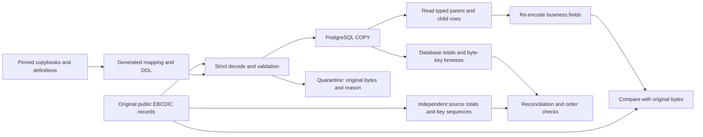

# CardDemo data component

This component moves the five public CardDemo VSAM files into generated PostgreSQL
tables and checks what arrived. It also generates the two pending-authorization
segment tables and exercises them with explicitly synthetic IMS fixtures.
The CICS services and web screens are a separate component.

## What is generated

`spec/modernization/carddemo-data/provenance.json` pins AWS CardDemo commit
`59cc6c2fd7ebd7ef7925cad552a01a4b8b6e4d5e` and every original file's byte hash.
The slice configuration associates files with their source definitions; it contains
no handwritten column mappings. `mapping/<table>.json` traces columns to copybook
lines, keys to IDCAMS statements, and segment tables to DBD statements. Generated
DDL, mappings, receipts and source hashes are CI artifacts.

Numeric fields become exact `numeric` columns, character fields retain their full
width, ten-character `*-DATE` fields have an ISO date interpretation plus original
text, and OCCURS entries use child tables with ordinals. Invalid dates are
quarantined as complete original records. REDEFINES without a reviewed discriminator
and live-reader policy is refused. Nested OCCURS migration is also refused.
The decoder's broader capabilities are not automatically claimed as migration support.

Primary and alternate keys are extracted from the original EBCDIC bytes into indexed
`bytea` columns. No database text collation decides browse order. Both CARDDATA and
CARDXREF have nonunique alternate account indexes. ESDS and RRDS plans carry RBA or
slot keys; loading requires explicit captured positions and never invents them.

## How the proof works



The encoder never uses a saved whole record as its answer. It rebuilds business
fields from PostgreSQL values. Filler bytes and numeric representation metadata
(including positive C/F signs and negative zero) are retained separately because
they cannot be recovered from a numeric value or checksum. Deliberately changing a
database amount, date or child row must make the proof divergent.

Reconciliation accounts for accepted and quarantined records exactly once. It
compares numeric sums for accepted records and separately verifies each quarantined
record's bytes. Quarantine is not silent acceptance and still needs operator review.
An empty accepted population is indeterminate, never an equivalent round trip.

Browse checks include every observed start key, low/high boundary starts, full
browses, generic prefixes and reverse order. Duplicate alternate keys use the
primary key as a deterministic tie-breaker. This is a public-byte-order reference;
no live VSAM STARTBR/READNEXT/READPREV capture has been compared.

## IMS boundaries

The segment schema includes parent path foreign keys, full path keys and captured
twin sequence numbers. A generated two-root fixture compares a Python byte-stream
reference with PostgreSQL traversal and reconstructed segment bytes.

The public IMS file is retained unchanged, but its utility framing is not decoded.
IBM documents that DFSURGU0 adds prefixes to unloaded segments; a plain copybook
decoder cannot safely strip them by guessing. The public-unload gate therefore
remains indeterminate. [IBM utility documentation](https://www.ibm.com/docs/en/ims/15.4.0?topic=rcu-hd-reorganization-unload-utility-dfsurgu0).

The LCHILD relationship is recorded with its DBD statement and marked unresolved;
it is not silently advertised as implemented secondary-index behavior. Full DL/I
positioning, GU/GN/GNP update semantics and the existing 40-case conformance replay
are not implemented by this data-load proof. Nor does it replace the existing
`readiness/ims-expiry` qualification. The known duplicated approved-count deletion
test remains a source quirk; no program behavior was changed.

## Execution

Development validation runs only in GitHub Actions. The workflow uses the existing
immutable PostgreSQL 16 image and the pinned Psycopg driver. COPY runs inside
transactions, with per-record savepoints so rejected child rows cannot leave a
partial parent. See [Psycopg COPY](https://www.psycopg.org/psycopg3/docs/basic/copy)
and [transaction semantics](https://www.psycopg.org/psycopg3/docs/basic/transactions.html).

For a separately authorized local demonstration, the data-only Compose bundle is:

```sh
docker compose -f factory/carddemo-data/compose.yaml up --build
```

It starts PostgreSQL on loopback port 55432, loads public data, and writes evidence
under `work/carddemo-compose-evidence`. It refuses existing schemas or evidence
directories; it does not overwrite a previous run. The demonstration password is
public and only for this isolated fixture. This bundle contains no web UI or SSO.
The Compose path itself is not a locally observed result.

## Scope of an unsigned review

The receipt separates byte round trip, reconciliation, browse order, generated IMS
traversal, and unmeasured gates. Its overall state remains indeterminate while IMS
unload, relationships or other required evidence are missing. A green CI job means
the bounded tests passed; it does not mean all migration requirements passed.
No receipt authorizes a customer release, z/OS equivalence, signing or activation.

The design's remaining choices for Howard are the future front-end approach,
production SSO/design-system integration, DL/I compatibility versus SQL rewrites,
and the eventual CICS baseline. This data component follows the recommended
space-preserving character mapping and leaves those later decisions open.
